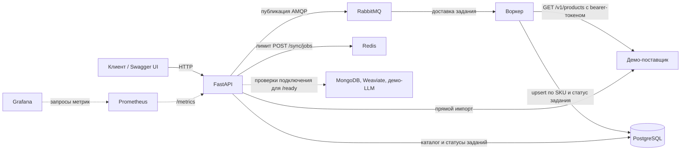

# Catalog Sync API

Backend на FastAPI для импорта каталога товаров из API поставщика. Демо-поставщик поднимается отдельным процессом и отдаёт два вымышленных товара. Backend обращается к нему по HTTP, проверяет ответ и сохраняет товары. В профиле Compose используется PostgreSQL, а задания можно отправлять в RabbitMQ отдельному воркеру.

## Запуск с Docker Compose

Для полного демо нужен запущенный Docker с Compose v2. При первом запуске выполните эти команды из корня репозитория.

```bash
cp .env.example .env
docker compose up --build -d
curl -fsS --retry 15 --retry-delay 1 --retry-connrefused http://127.0.0.1:8000/ready
```

Дождитесь `"ready": true`. Откройте Swagger UI, выполните `POST /sync/jobs` и проверьте результат по `task_id` через `GET /sync/jobs/{task_id}`. [Swagger UI](http://127.0.0.1:8000/docs).

Шаблон уже содержит тестовый токен, порты и настройки лимита. Адреса внутренних сервисов задаёт Compose, поэтому для локального демо достаточно скопировать шаблон. Если порт занят, измените соответствующее значение в `.env` и используйте новый порт в URL. Файл `.env` исключён из Git. [Шаблон окружения](.env.example) · [Prometheus](http://127.0.0.1:9090/targets) · [Grafana](http://127.0.0.1:3000).

Остановить стек можно командой `docker compose down`. Данные PostgreSQL сохранятся в томе.

## Архитектура



Воркер записывает товары и статус `succeeded` в одной транзакции PostgreSQL, затем подтверждает сообщение RabbitMQ. `GET /ready` проверяет все настроенные зависимости. Prometheus собирает метрики backend, RabbitMQ и экспортёров Redis и MongoDB. [Контракты инфраструктуры](docs/infrastructure.md).

## Демо на собеседовании за 3–5 минут

Поднимите Compose заранее. Команды ниже используют порт backend по умолчанию.

1. **Покажите готовность сервисов.** В ответе `GET /ready` виден статус каждой зависимости. Откройте Swagger UI, чтобы показать контракт API. [Swagger UI](http://127.0.0.1:8000/docs).

   ```bash
   curl -fsS http://127.0.0.1:8000/ready
   ```

2. **Проведите задание от API до базы.** Вызовите `POST /sync/jobs` в Swagger. Ответ `202 Accepted` содержит `task_id` и заголовок `Location`. Вставьте ID в `GET /sync/jobs/{task_id}` и дождитесь `succeeded` с `processed: 2`. Затем покажите `GET /products`. При повторном задании остаются те же два товара благодаря upsert по SKU.

3. **Покажите сбой поставщика.** Выполните `docker compose stop supplier` и отправьте новое задание. Запросите его статус до появления `failed` с `error: supplier_error`. В `GET /products` по-прежнему видны оба товара. После проверки выполните `docker compose start supplier`.

4. **Покажите лимит Redis.** Быстро отправьте шесть запросов с одного адреса. При настройках по умолчанию один из ответов будет `429 Too Many Requests`, а `Retry-After` покажет, сколько секунд ждать.

   ```bash
   for i in 1 2 3 4 5 6; do
     curl -sS -D - -o /dev/null -X POST http://127.0.0.1:8000/sync/jobs
   done
   ```

## Быстрый запуск с SQLite

Понадобятся Python 3.11+ и `uv`. Этот режим запускает HTTP-поставщика и синхронный импорт в SQLite. Для фоновых заданий и лимита Redis используйте Docker Compose.

Выполните команды из корня репозитория. Если `.env` уже создан, пропустите копирование.

```bash
cp .env.example .env
uv sync --locked
```

Запустите поставщика и backend в двух терминалах. В примере поставщик проверяет тестовый bearer-токен, который backend отправляет в HTTP-заголовке.

```bash
uv run --locked --env-file .env uvicorn app.demo_supplier:app --port 8001
```

```bash
uv run --locked --env-file .env uvicorn app.main:create_app --factory --port 8000
```

Откройте [Swagger UI](http://127.0.0.1:8000/docs) или выполните запросы в терминале.

```bash
curl -fsS http://127.0.0.1:8000/health
curl -fsS -X POST http://127.0.0.1:8000/sync
curl -fsS http://127.0.0.1:8000/products
```

## Поведение

- `POST /sync` получает товары через `GET /v1/products` поставщика. Его поля `code`, `title` и `amount` преобразуются в `sku`, `name` и `price_cents`.
- Импорт проверяет все записи до сохранения. Одна транзакция добавляет новые SKU и обновляет существующие. Повторный импорт тех же данных даёт тот же каталог. Товары, пропущенные в очередном ответе, остаются в каталоге.
- При тайм-ауте backend отдаёт `504`. Ошибка запроса к поставщику или некорректные данные дают `502`. В обоих случаях прежний каталог сохраняется.
- `GET /products` читает сохранённый каталог из выбранной БД. Поле `processed` в ответе синхронного импорта показывает число записей в ответе поставщика.
- `GET /sync/jobs/{task_id}` возвращает статус `queued`, `running`, `succeeded` или `failed`. Для успешного задания доступно число обработанных записей, для сбоя — код ошибки. Неизвестный UUID даёт `404`.
- При заданном `REDIS_URL` запросы создания заданий учитываются по IP клиента в фиксированном окне. После исчерпания лимита API отвечает `429` с `Retry-After`. При сбое Redis этот маршрут возвращает `503`.

| Переменная | Назначение | Значение по умолчанию |
| --- | --- | --- |
| `SUPPLIER_URL` | Базовый URL API поставщика | `http://127.0.0.1:8001` |
| `SUPPLIER_TOKEN` | Bearer-токен для запроса к поставщику | `local-demo` в шаблоне и Compose |
| `DATABASE_PATH` | Путь к SQLite | `data/catalog.sqlite3` |
| `POSTGRES_DSN` | DSN для каталога и статусов заданий в PostgreSQL | Пусто |
| `REDIS_URL` | Подключение к Redis для лимита запросов | Пусто, в Compose задан |
| `SYNC_JOB_RATE_LIMIT` | Число запросов создания заданий на IP за окно | `5` |
| `SYNC_JOB_RATE_WINDOW_SECONDS` | Длительность окна в секундах | `60` |

## Код и тесты

- `app/main.py` содержит HTTP-маршруты и настройку зависимостей.
- `app/supplier.py` содержит HTTP-клиент и преобразование ответа поставщика.
- `app/catalog.py` содержит модель товара и операции с каталогом. `app/database.py` управляет транзакциями SQLite и PostgreSQL.
- `app/jobs.py` хранит статусы заданий. `app/rate_limit.py` считает запросы и устанавливает TTL в Redis одной атомарной операцией.
- `app/queue.py` и `app/worker.py` содержат публикацию и обработку заданий RabbitMQ.

```bash
uv run --locked pytest -q
uv run --locked ruff check .
```

Локальные тесты используют временную SQLite и подменяют HTTP-транспорт. GitHub Actions дополнительно поднимает Docker Compose и проверяет доставку через RabbitMQ, сохранение в PostgreSQL, повторный импорт, сбой поставщика и лимит Redis. [Workflow CI](.github/workflows/ci.yml).
