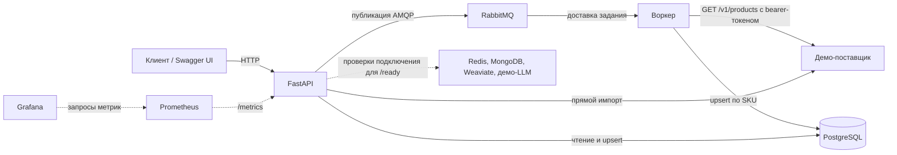

# Catalog Sync API

Backend на FastAPI для импорта каталога товаров из API поставщика. Демо-поставщик поднимается отдельным процессом и отдаёт два вымышленных товара. Backend обращается к нему по HTTP, проверяет ответ и сохраняет товары. В профиле Compose используется PostgreSQL, а задания можно отправлять в RabbitMQ отдельному воркеру.

## Архитектура



Воркер подтверждает сообщение RabbitMQ после записи товаров в PostgreSQL. `GET /ready` также проверяет подключения к RabbitMQ и PostgreSQL. Prometheus собирает метрики backend, RabbitMQ и экспортёров Redis и MongoDB. [Контракты инфраструктуры](docs/infrastructure.md).

## Стек Docker Compose

```bash
docker compose up --build -d
curl -fsS --retry 15 --retry-delay 1 --retry-connrefused http://127.0.0.1:8000/ready
```

Порты на хосте можно задать через `DEMO_API_PORT`, `DEMO_PROMETHEUS_PORT` и `DEMO_GRAFANA_PORT`. [Swagger UI](http://127.0.0.1:8000/docs) · [Prometheus](http://127.0.0.1:9090/targets) · [Grafana](http://127.0.0.1:3000).

## Демо на собеседовании за 3–5 минут

Поднимите Compose заранее. Команды ниже используют порт backend по умолчанию.

1. **Покажите готовность сервисов.** В ответе `GET /ready` виден статус каждой зависимости. Откройте Swagger UI, чтобы показать контракт API. [Swagger UI](http://127.0.0.1:8000/docs).

   ```bash
   curl -fsS http://127.0.0.1:8000/ready
   ```

2. **Проведите задание от API до базы.** Покажите `202 Accepted` и `task_id`. Найдите тот же ID в строке `Sync job completed` у воркера, затем запросите каталог. Расскажите, как воркер получает JSON по HTTP и делает upsert по SKU. При повторном импорте в каталоге остаются те же два товара.

   ```bash
   curl -sSi -X POST http://127.0.0.1:8000/sync/jobs
   docker compose logs --tail 20 worker
   curl -fsS http://127.0.0.1:8000/products
   ```

3. **Покажите сбой внешней интеграции.** Остановите поставщика и вызовите синхронный импорт. API вернёт `502`, а сохранённые товары останутся доступны. После показа запустите поставщика снова.

   ```bash
   docker compose stop supplier
   curl -sSi -X POST http://127.0.0.1:8000/sync
   curl -fsS http://127.0.0.1:8000/products
   docker compose start supplier
   ```

## Быстрый запуск с SQLite

Понадобятся Python 3.11+ и `uv`. Выполните команды из корня репозитория.

```bash
uv sync --locked
```

Запустите поставщика и backend в двух терминалах. В примере поставщик проверяет тестовый bearer-токен, который backend отправляет в HTTP-заголовке.

```bash
SUPPLIER_TOKEN=local-demo uv run --locked uvicorn app.demo_supplier:app --port 8001
```

```bash
SUPPLIER_TOKEN=local-demo uv run --locked uvicorn app.main:create_app --factory --port 8000
```

Откройте [Swagger UI](http://127.0.0.1:8000/docs) или выполните запросы в терминале.

```bash
curl -fsS http://127.0.0.1:8000/health
curl -fsS -X POST http://127.0.0.1:8000/sync
curl -fsS http://127.0.0.1:8000/products
```

## Поведение

- `POST /sync` получает товары через `GET /v1/products` поставщика. Его поля `code`, `title` и `amount` преобразуются в `sku`, `name` и `price_cents`.
- Импорт проверяет все записи до сохранения. Одна транзакция добавляет новые SKU и обновляет существующие. Повторный импорт тех же данных даёт тот же каталог. Товары, пропущенные в очередном ответе, остаются в каталоге.
- При тайм-ауте backend отдаёт `504`. Ошибка запроса к поставщику или некорректные данные дают `502`. В обоих случаях прежний каталог сохраняется.
- `GET /products` читает сохранённый каталог из выбранной БД. Поле `processed` в ответе синхронного импорта показывает число записей в ответе поставщика.

| Переменная | Назначение | Значение по умолчанию |
| --- | --- | --- |
| `SUPPLIER_URL` | Базовый URL API поставщика | `http://127.0.0.1:8001` |
| `SUPPLIER_TOKEN` | Bearer-токен для запроса к поставщику | Пусто |
| `DATABASE_PATH` | Путь к SQLite | `data/catalog.sqlite3` |
| `POSTGRES_DSN` | DSN для хранения каталога в PostgreSQL | Пусто |

## Код и тесты

- `app/main.py` содержит HTTP-маршруты и настройку зависимостей.
- `app/supplier.py` содержит HTTP-клиент и преобразование ответа поставщика.
- `app/catalog.py` содержит модель товара и адаптеры SQLite и PostgreSQL.
- `app/queue.py` и `app/worker.py` содержат публикацию и обработку заданий RabbitMQ.

```bash
uv run --locked pytest -q
uv run --locked ruff check .
```

Тесты подменяют транспорт HTTP-клиента и используют временную SQLite. Они проверяют токен в исходящем запросе, повторную синхронизацию, сохранение данных после перезапуска приложения и ошибки поставщика.
